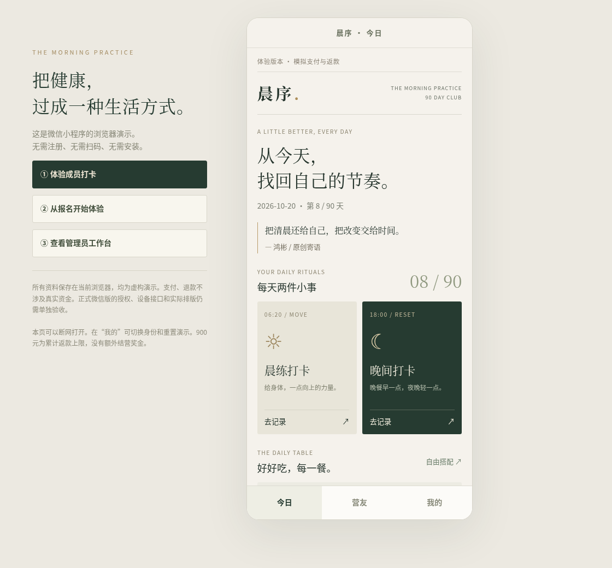

# hongbin-fitness-mini

90天晨练减脂营第一版：原生微信小程序 + 共享业务引擎 + 微信云函数骨架。默认本机模拟模式，不扣款、不实际退款，请使用虚构资料。

## 最简单的预览方式（无需微信账号）

下载本分支ZIP并解压，**双击根目录的 `双击打开演示.html`**，用Chrome或Edge打开即可。不需要注册小程序、AppID、微信开发者工具、Node.js或服务器。

左侧三个按钮可直接体验成员打卡、新人报名和管理员工作台。页面完全离线运行，复用小程序实际的Page处理器、业务引擎和编译后的WXML，不连接微信账号、不真实扣款。浏览器效果不等于微信真机验收；相册、支付、消息等平台接口仍需在微信版单独验证。

浏览器预览文件已包含在仓库中。开发者修改小程序后执行 `npm run build:preview` 重新生成单文件；普通体验者不用执行命令。



## 立即演示

1. 使用微信开发者工具导入本仓库根目录；项目配置已指定 `miniprogram/`。没有AppID可先使用测试号/游客导入，默认不使用云服务。
2. 保持 `miniprogram/config.js` 的 `mode: 'demo'`。本机演示无第三方依赖，无需云环境、支付凭证或先安装npm包。
3. 默认进入虚构成员“林晓”：第一周已完成5天，可查看70元模拟返款资格；第二周可操作今日打卡。
4. “我的 → 演示控制台 → 切换演示身份”支持林晓、周远、新报名用户、管理员。
5. 新用户走健康筛查、协议确认、模拟支付；开营前可点“演示：跳至我的开营日”。管理员可审核心得、查看周表、复制CSV、模拟退款及推进业务日期。

详细流程：[演示指南](docs/demo-guide.md)。演示日期可以推进，重置可恢复初始虚构数据。微信原生编译、真机体验和实际平台授权需要在开发者工具中验证；本仓库自动化检查不替代这些验证。

## 最新业务规则

- 报名900元，90天，每周5个有效日、2天免打卡。
- 前12个训练周达标各返70元，最后6天完成4天返60元，累计最多900元。
- **无额外900元或其他结营奖金。** 单周未达标不取消其他周资格。
- 15—20斤为适合者的减重挑战方向，不承诺人人达到；体重结果不追溯扣回周返款。
- 运动饮食按个人合理计划执行；健康筛查、协议和内容均为待审定草稿。

## 功能

| 部分 | 已实现 |
| --- | --- |
| 今日 | 未付费介绍、周期进度、运动饮食记录、免打卡、返款资格 |
| 营友 | 同期心得、选填本机图片、待审仅本人可见、审核、点赞、举报 |
| 我的 | 体重腰围记录、趋势、13周期记录、订单退款明细、服务申请、协议 |
| 管理 | 周期选择、成员7日表、统计分母、CSV、审核、申请处理、结算、演示退款 |
| 业务引擎 | 北京时间、90天边界、订单规则快照、金额上限、幂等、身份及环境隔离 |
| 云函数 | 微信身份上下文、管理员白名单、私有状态事务、只返回授权视图、定时结算入口 |

## 开发与验证

本地验证使用Node.js 20或更新版本，根项目无第三方运行依赖：

```sh
npm ci
npm run check
npm test
```

`check` 检查JS/JSON、7页原生组件标签和事件，使用微信团队发布的 `miniprogram-compiler` 中的wcc/wcsc编译模板及样式，并生成云函数共享代码。测试实际驱动原生Page事件处理器、编译后的WXML渲染树及使用串行事务替身的云函数入口，覆盖完整演示链路、页面分支、越权、并发重试及900元上限。它们不执行真实微信支付、设备原生渲染或实际云数据库事务。

云端准备：

```sh
npm run build:cloud
npm ci --ignore-scripts --prefix cloudfunctions/api
```

根目录与云函数依赖均有锁文件，云SDK固定为4.0.2，开发期编译工具固定为0.2.3，其glob依赖覆盖为13.0.6。编译工具版本较旧，用于离线检查，不替代最新开发者工具验收。完整配置、权限与限制见[部署与数据安全说明](docs/deployment.md)。

## 真实上线状态

当前交付是可导入的演示MVP，**不是已上线的收费服务**。真实支付/退款适配器尚未实现，生产模式显式阻止下单、模拟支付和模拟退款；填入凭证不会自动开放真实收款。云图片、微信内容安全、订阅消息、专业评估及实际客服尚未接入。期次和模板在管理端只读；暂停申请可记录处理结果，但自动延期、特殊退款及历史打卡纠正仍需后续实现。

云端采用单私有状态文档事务，适合小规模验证；800KB前保护性拒绝写入，生产扩大规模须迁移分集合及独立审计归档。演示与生产必须使用独立环境，不能将虚构订单升级为真实订单。

产品依据：[需求文档](docs/mvp-requirements.md)。上线前还需完成运营主体、资质/平台审核、健康与法律审阅、隐私制度及奖励资金预算。

## 晨序视觉与三餐搭配更新

首页采用暖白、墨绿、香槟金和衬线字体。原创寄语：“把清晨还给自己，把改变交给时间。”——鸿彬。

晨练和晚间分别保存，共同形成当天有效记录，不重复计天。晚间是“18点前正常吃晚餐、之后按计划不加餐”，并非不吃晚饭。三餐页可直接选择家常均衡、便利轻食或植物友好组合，再展开更换主食、蛋白质、1—2种蔬菜及可选加配。共33种食材；支持5类食材偏好过滤，保存后在首页显示。搭配不自动产生打卡，份量仅为一般参考，需按个人情况调整。

浏览器版和微信原生版复用同一页面和业务逻辑。更新后重新下载 ZIP、解压，双击根目录的 `双击打开演示.html` 即可体验，无需注册或扫码。原有本机演示资料会继续保留；可在“我的”重置。
